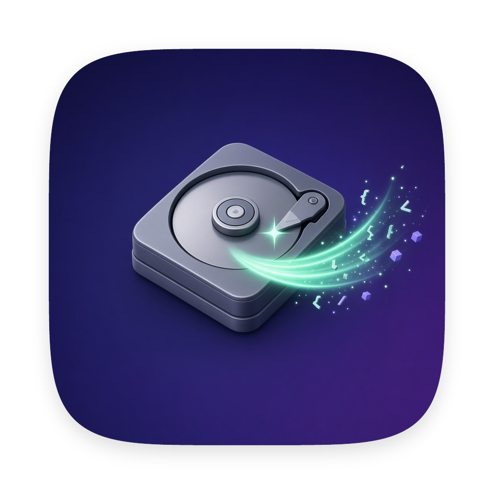

# DevDisk



[](https://github.com/dbendaou/devdisk/actions/workflows/ci.yml)

DevDisk is a native macOS app for reclaiming space on a developer’s disk. The main screen is **Smart cleanup**: a catalogue of the folders toolchains, package managers, IDEs, simulators, and container engines actually leave behind. Each suggestion names the ecosystem, the size, whether it is safe to regenerate, and the exact action (delete permanently, or a tool’s own prune command). A switch can send deletes to Trash instead.

A secondary **Explore** view is a squarified treemap and a size-sorted outline, for drilling into anything the rules do not name. It follows the same idea as [Disk Inventory X](https://github.com/diskinv/diskinv) (scan a folder, show a treemap, an outline, and a kind breakdown). The layout algorithm is an independent implementation of Bruls, Huizing, and van Wijk’s squarified treemaps. None of Disk Inventory X’s GPL code is copied. This project is MIT licensed.

Requires Apple Silicon and macOS 14 or later (the same deployment target as `Package.swift` and `App/Info.plist`). The scanning, accounting, rule engine, and treemap layout live in the `DevDiskCore` library, which builds and tests on Linux and macOS. The SwiftUI app is macOS-only. Apple platforms in the manifest are ignored on Linux.

## Screens

**Smart cleanup** opens first after a scan. A stepper, “Projects untouched for N+ days” (default 30), filters per-project folders such as `node_modules`, `.next`, `target`, and `.venv`. Global caches are always listed. Suggestions are grouped by ecosystem (JavaScript, Apple, Editors, Python, Rust, Go, Java & Android, Ruby, Containers, Databases, Tools). A card shows the headline, the safety level, what the folder is, the action, and, for project folders, the project name, last-modified date, and size. Preview records what would happen. The real button opens a confirmation sheet that lists every path and the total size. Confirming closes the sheet immediately. The card then shows **Deleting…** or **Running…**, the bytes freed so far, and an X that stops the task. What was already removed stays removed. When it finishes the card reads **Freed 5.7 GB** or the error. Other cards, the scan, and further deletes keep working.

**Explore** is a Map / Files / Kinds switch. Opening it starts a full walk beside cleanup. The map, file list, and kind totals update about once a second as directories are measured. A folder that is listed but not measured yet is a placeholder. The map is a squarified treemap coloured by file kind. Click a block to select it; click a selected folder to zoom in, or a selected file to reveal it in Finder. Files is an outline sorted by size, name, kind, or date, with the same Reveal action. Kinds is the extension and kind breakdown.

The header shows the volume’s total, used, and free space, plus **estimated reclaimable**. Container prune cards are included as an upper bound (“up to N”) because `docker system prune` does not shrink the disk image to zero. `git gc` and `simctl delete unavailable` are shown with their on-disk size but are not added to the total, because they only reclaim part of it.

## Build and test

```sh
make test          # swift test, Linux or macOS
make app           # macOS only: dist/DevDisk.app, ad-hoc signed
open dist/DevDisk.app
```

`make test` runs `swift test`. On macOS it also builds the `DevDisk` product, so the app target is type-checked even when test discovery only depends on the library. `make app` runs `swift build -c release --product DevDisk`, renders `packaging/AppIcon-1024.png` into an iconset (Pillow, or `sips` on the committed masked PNG if Pillow is missing), runs `iconutil` into `Contents/Resources/AppIcon.icns`, copies `.build/release/DevDisk` into `dist/DevDisk.app`, writes `Contents/PkgInfo`, and runs `codesign --force --deep -s -`. No Xcode project is required. Command Line Tools are enough. GitHub Actions runs the tests on Ubuntu and builds the app on macOS. The repository is [dbendaou/devdisk](https://github.com/dbendaou/devdisk).

Scan your home folder for the full catalogue. A smaller folder only matches rules whose paths sit inside it.

## Catalogue

Rules are data in `CleanupCatalog`. Adding one is a new `RuleSpec`: an id, ecosystem, summary, safety level, a locator, and an effect. Earlier rules claim a path, so a file inside DerivedData is not also offered as a loose database file.

Per-project rules use the parent directory’s modification time (the project). The age stepper re-runs the engine without scanning again. Set it to 0 to include every project.

| Ecosystem | What it finds | Action | Safety |
| --- | --- | --- | --- |
| JavaScript | `node_modules`, `.next`, `.nuxt`, `.turbo`, `.parcel-cache` (past the age threshold, next to a project); `dist` next to `package.json` | Delete | Safe, except `dist` which is Review |
| JavaScript | npm, Yarn, pnpm, and Bun caches; `~/Library/pnpm` and `~/.pnpm-store` | Delete | Safe. The pnpm store is removed wholesale, not merely pruned |
| Apple | Xcode DerivedData, iOS/watchOS/tvOS DeviceSupport, CoreSimulator caches, SwiftPM caches (`org.swift.swiftpm`, `~/.cache/swiftpm`, `~/.cache/swifterpm`), CocoaPods, `.build` next to `Package.swift` | Delete | Safe |
| Apple | Xcode archives | Delete | Review |
| Apple | CoreSimulator Devices | `xcrun simctl delete unavailable` | Safe. Size is the whole Devices folder and is not added to the estimate |
| Editors | JetBrains caches and logs; VS Code and Cursor cache, CachedExtensions, and CachedExtensionVSIXs | Delete | Safe. Settings and `~/.cursor` chat data are not included |
| Python | pip, uv, Poetry, and Conda `pkgs` caches | Delete | Safe. Conda environments are not included |
| Python | `.venv`, `venv`, other folders with `pyvenv.cfg`, and `__pycache__`, past the age threshold | Delete | Virtualenvs are Review. Bytecode is Safe |
| Rust | `target/` next to `Cargo.toml`; `~/.cargo/registry` and `~/.cargo/git` | Delete | Safe. `~/.cargo/bin` is not included |
| Go | `~/go/pkg/mod`, `~/Library/Caches/go-build`, `~/.cache/go-build` | Delete | Safe |
| Java & Android | Gradle caches and daemon files | Delete | Safe |
| Java & Android | `~/.m2/repository`, Android SDK `system-images`, `~/.android/avd` | Delete | Review |
| Ruby | `~/.bundle/cache`, and `vendor/cache` in projects past the age threshold | Delete | Safe |
| Containers | Docker Desktop, OrbStack, Colima/Lima, Podman disk or storage | `docker system prune -af`, `colima ssh -- docker system prune -af`, or `podman system prune -af` | Review. The image file is never deleted. The size is an upper bound and is included in the estimate |
| Databases | Postgres (`PG_VERSION`), MySQL (`ibdata1`), MongoDB (`mongod.lock`), Redis dumps, SQLite/`.db` files of 50 MB or more | Delete | Always Review |
| Tools | Homebrew cache | Preview runs `brew cleanup -n -s`. Confirming runs `brew cleanup -s` | Safe |
| Tools | Playwright, Puppeteer, and Cypress browser caches; `~/.terraform.d/plugin-cache`; per-project `.terraform` next to a `.tf` file | Delete | Safe |
| Tools | `.log` files of 5 MB or more, past the age threshold | Delete | Review |
| Tools | `.git` directories of 50 MB or more, past the age threshold | `git gc --prune=now` in that repository | Review. The repository is not deleted. The size is not added to the estimate |

## How a scan runs

Scan Home does not walk every file. It measures known cache paths first (so JetBrains, npm, DerivedData, and the rest show up as soon as each folder is sized), then lists project directories looking for artefact names. It does not enter `node_modules`, `.git`, `.venv`, DerivedData, or the other matched build folders; a separate concurrent pass sums allocated size for those. It also skips `~/Library` (already probed by path), photos, and media folders. Cards appear while that scan is still running, and each one can be deleted immediately. Cancel keeps whatever has already been found.

The Explore map is a separate full walk. Use **Build map** when you want the treemap. It is not part of Scan Home.

## Safety

- The default action is **Delete permanently** (`FileManager.removeItem`), off the main thread. On the same volume the folder is renamed aside first so it disappears from the scan immediately, then deleted in the background so the space is freed without freezing the window.
- A confirmation sheet lists every path and the total and says the delete cannot be undone. **Review** items, including every database rule, also require a second acknowledgement on that sheet.
- **Move to Trash** is an optional switch. It uses `FileManager.trashItem` instead of permanent deletion.
- **Preview** writes a log entry and does not delete. Homebrew’s preview is the exception: it runs `brew cleanup -n -s`, which only prints brew’s report.
- **Safe** means the bytes are regenerable (caches, build output, bytecode). **Review** means the folder may hold data: databases, archives, virtualenvs, Android images, `dist`, logs, or a container prune.
- Database rules are Review and never Safe.
- Every completed deletion is appended to the log.
- Nothing outside the scanned folder is touched. The scan root itself is never deleted.
- Refused even inside the scan: `/System`, `/usr`, `/bin`, `/sbin`, `/Library`, `/etc`, `/dev`, `/opt`, `/Applications`, `/private/etc`, `/private/var`, and `/var` (the macOS symlink to `/private/var`). The per-user temp area `/var/folders` and `/private/var/folders` is not part of that list, so a scan rooted in `NSTemporaryDirectory` still works. Also refused: `~/Library/Keychains`, `~/Library/Mail`, and any Photos library (`.photoslibrary`). A home folder such as `/Users/<name>` is not a system path. Checks do not resolve symlinks, so `/home` and `/tmp` stay the paths you named.
- A folder is skipped if deleting it would take a protected descendant with it.
- Tool commands are an allowlist of bare names (`brew`, `docker`, `podman`, `colima`, `xcrun`, `git`, …). The app does not invoke a shell. `git gc` is run once per repository with `git -C <repo>`.
- Sizes are allocated bytes (`st_blocks * 512`), not logical size. Symlinks are not followed and the walk does not enter another volume. The Explore walk counts a hard link once, on the lexicographically first path. The cleanup size pass does not, so a rare hard-linked cache can be counted twice. Permission errors are recorded and those folders are not suggested.
- A log of previews and completed cleanups is kept in `~/Library/Application Support/DevDisk/removal-log.json`.

## What Linux CI checks

`make test` on Linux runs the library tests: allocated versus logical size (including a sparse file), symlink and hard-link accounting, permission errors, cancellation, not crossing a volume, the squarified layout, the full cleanup catalogue, and the fast cleanup scan (known caches stream before a blocked walk, `Library` is not entered, a suppressed path is not reported again, and permanent delete is the default). Spotify, Steam, Downloads, Trash, and Claude app data are present as decoys and must not be suggested.

The SwiftUI app, Finder reveal, Trash, and `codesign` are not executed here. `make app` is what the macOS CI job runs.

## License

MIT. See [LICENSE](LICENSE).
